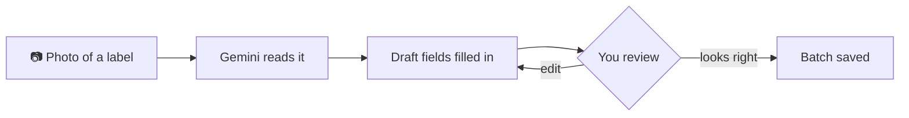

<p align="center">
  
</p>

<h1 align="center">Stocked</h1>

<p align="center">
  <em>Know what's in the pantry, and what's about to expire.</em>
</p>

<p align="center">
  <a href="LICENSE"></a>
  
  
  
</p>

Stocked is a self-hosted tracker for food, medicine and household supplies. Every purchase becomes a batch with its own location and expiry date, so you always know what you have and what to use first. Point your phone at a label and an optional Gemini scan fills in the form for you.

## How adding an item works



## Features

- **Pantry**: search, filter by category or location, and sort by name, expiry or stock.
- **Products and batches**: one product can have many purchases. The total on hand is the sum of the batch counts.
- **Photo add**: take or upload label photos, and review what Gemini drafted before saving.
- **History**: every change to a batch count is logged.
- **Reports**: a table with CSV export and print.
- **Catalog**: edit categories, locations, package types and units.
- **Backup and restore**: export everything to one file and restore it on a new install.
- **Import**: load an existing Google Sheets CSV.

## Quick start

Requires Node.js 22 or later. Photo reading also needs a [Gemini API key](https://aistudio.google.com/).

```bash
git clone https://github.com/mohdahmedasif/stocked.git
cd stocked
cp .env.example .env    # set ADMIN_KEY
npm install
npm run install:all
npm run dev
```

Open http://127.0.0.1:5173. Vite serves the UI and proxies `/api` to the Express server on port 3000.

To run the production build locally, use `npm run build` followed by `npm start`, then open http://127.0.0.1:3000.

## Run with Docker

```bash
cp .env.example .env    # set ADMIN_KEY
docker compose up -d --build
```

The app runs on port 3000, or the `PORT` you set. Data lives in the `stocked-data` volume.

## Configuration

Two environment variables are read from `.env`:

| Variable | Description |
|----------|-------------|
| `PORT` | Port the app listens on. Defaults to `3000`. |
| `ADMIN_KEY` | Required. Pairs a new browser and resets a forgotten PIN. |

Everything else, including expiry windows, the Gemini model, the app name and Gemini keys, is set on the Settings page. Categories, locations and units live in the Catalog.

Gemini keys are encrypted with the `secret.key` file in the data directory. If that file is lost, saved keys must be entered again.

Never commit `.env`, `secret.key`, a database file or a backup file.

## Access

1. **Pair the device.** A browser is paired once with the admin key. The pairing lasts a year and is renewed each time a PIN is entered on that device.
2. **Unlock a profile.** Each person has a profile protected by a 4 to 8 digit PIN.

Each profile has its own inventory, history, catalog and settings, stored in a separate database file. Five wrong PINs lock the profile for a minute, and further wrong attempts extend the lock up to two hours. A forgotten PIN can be reset with the admin key, and a lost device can be removed under **Settings → Unpair other devices**.

PINs are stored as salted scrypt hashes, and device and session tokens as SHA-256 hashes. The PIN guards the app; the database file itself is not encrypted.

Run the app behind HTTPS whenever it is reachable from the internet. Without HTTPS, cookies are sent without the `Secure` flag, so anyone who can watch the traffic could capture them.

## Install as an app

Over HTTPS, or on `localhost`, browsers offer **Install app** or **Add to Home Screen**. Inventory data is never stored on the device, so changes always need the server.

## Data model

| Entity | Meaning |
|--------|---------|
| **Product** | An item you stock, matched by name and category |
| **Company** | The brand of a purchase |
| **Batch** | One purchase, with its count, location, size, expiry and acquired date |

A purchase identical to an existing batch increases that batch's count. Any other purchase creates a new batch.

**Backup:** on the Import page, choose **Full backup** to download a JSON file. Restoring it replaces the current profile's contents. Gemini keys, PINs and paired devices are not included.

**Google Sheets:** export the sheet as CSV, then use the Import page or run `npm run import:sheet -- path/to/export.csv`. Rows with the same name and category merge into one product, and each row becomes a batch.

## Deployment

**Docker image:** when a change is merged to `main`, [GitHub Actions](.github/workflows/build-deploy.yml) tests it and publishes an image to GitHub Container Registry. On the server, run:

```bash
bash scripts/deploy-image.sh
```

**Build on the server:** `docker compose up -d --build`

**systemd:**

```bash
npm run install:all && npm run build
sudo cp deploy/inventory.service /etc/systemd/system/inventory.service
# Edit User= and the paths in the unit file, then:
sudo systemctl daemon-reload
sudo systemctl enable --now inventory
```

**Without Docker:** `bash scripts/deploy.sh` pulls `main`, installs dependencies, rebuilds the client and restarts the service.

## Contributing

Contributions are welcome. Start with [CONTRIBUTING.md](CONTRIBUTING.md), and please follow the [Code of Conduct](CODE_OF_CONDUCT.md). Report vulnerabilities privately as described in [SECURITY.md](SECURITY.md).

## License

Released under the [MIT License](LICENSE).
